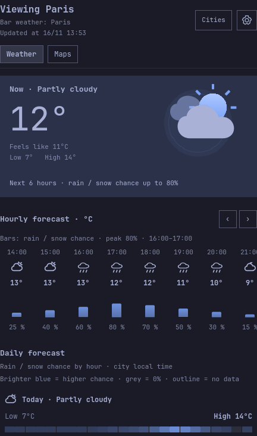
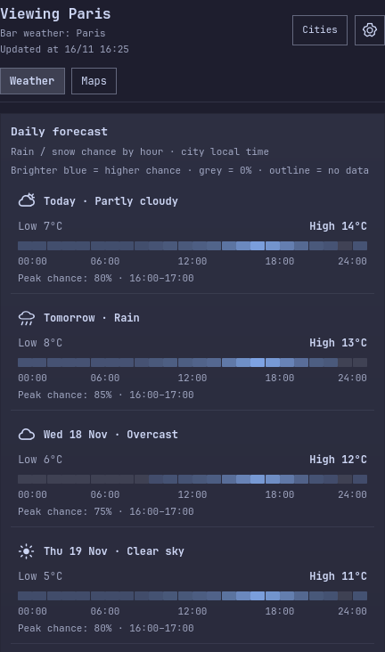
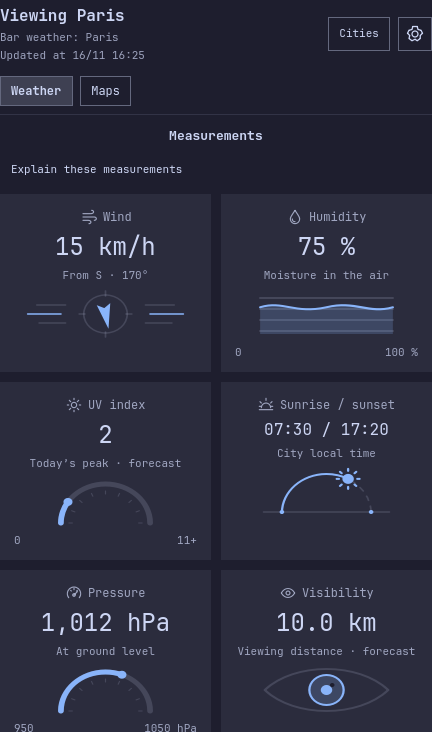
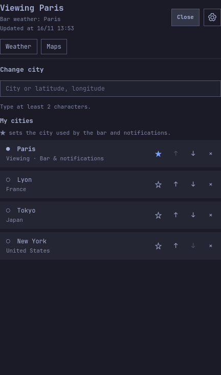
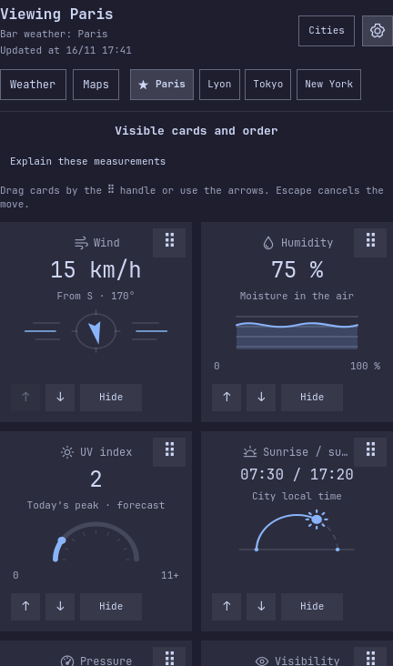
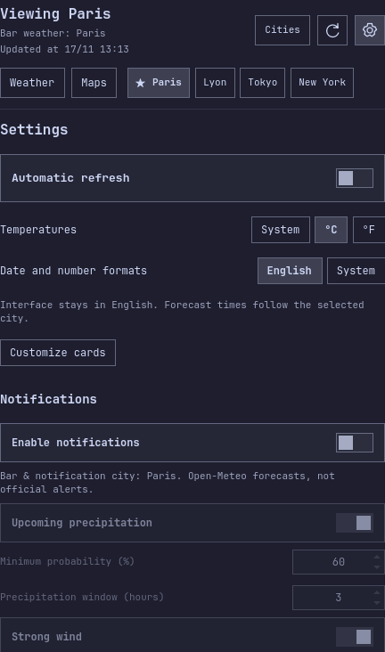

<div align="center">

# OWEE

**Omarchy Weather Enhanced Experience**

Pixel Weather clarity. Omarchy character.

[](https://github.com/Plapie690/omarchy-owee/actions/workflows/ci.yml)
[](LICENSE)
[](https://omarchy.org)

[The idea](#the-idea) · [A closer look](#a-closer-look) · [Install](#install) · [Reading the weather](#reading-the-weather) · [Under the hood](#under-the-hood)



</div>

## The idea

I wanted checking the weather to feel useful and pleasant: a small, expressive
widget in the bar, and a clear forecast when you open it. The starting point was
the clarity and playful atmosphere of Pixel Weather, brought into Omarchy's
colors, typography and desktop controls. Omarchy's native World Clock was also
a reference for coordinated motion and integration with the shell.

The project grew through everyday questions: *What is it like outside? When
might it rain? What do these bars actually tell me?* Those questions shaped the
interface, from the custom weather symbol to the hourly rain timelines.

The design follows a few simple principles:

- **Recognize the weather immediately.** Distinctive weather marks communicate
  the condition, with the temperature always visible in the bar.
- **Give each graphic a purpose.** Temperatures have explicit Low/High labels.
  Daily precipitation uses a 00:00–24:00 timeline so you can locate likely rain
  periods directly.
- **Make motion feel connected.** The weather illustration and forecast sections
  share a short opening progression. Weather movement stays active while viewed;
  closing the panel stops it. Reduced motion follows Omarchy.
- **Keep the desktop familiar.** Theme colors, type, spacing and controls follow
  Omarchy. Optional system formats adapt dates, numbers and temperature units.
- **Let the view fit the person.** Reorder measurement cards, hide what you do
  not need, save favorite cities and choose the city shown in the bar.
- **Be clear about uncertainty.** Forecast, observed radar, cached data and
  unavailable information have distinct labels. Missing data remains missing.

## A closer look

Captures show the actual plugin interface with illustrative sample data.
They demonstrate the layout and interactions, rather than a live forecast.

<table>
  <tr>
    <td align="center" width="50%">
      <strong>When might it rain?</strong><br>
      <sub>Daily forecasts with local-time precipitation timelines.</sub><br><br>
      
    </td>
    <td align="center" width="50%">
      <strong>Measurements with context</strong><br>
      <sub>Readable values, units and purpose-built visual indicators.</sub><br><br>
      
    </td>
  </tr>
  <tr>
    <td align="center">
      <strong>Explore without losing your home weather</strong><br>
      <sub>The viewed city and the bar's primary city are separate choices.</sub><br><br>
      
    </td>
    <td align="center">
      <strong>Your cards, your order</strong><br>
      <sub>Drag to reorder measurements and choose which cards stay visible.</sub><br><br>
      
    </td>
  </tr>
</table>

<details>
<summary><strong>Settings and notification controls</strong></summary>
<br>
<p align="center">
  
</p>

The interface stays in English. Select **System** to follow your desktop's
measurement system or date and number formats. Manual Celsius/Fahrenheit choices
remain available. Notifications are opt-in and support thresholds, quiet hours
and a daily summary.

</details>

## Install

```sh
omarchy plugin add https://github.com/Plapie690/omarchy-owee.git --enable
```

Update:

```sh
omarchy plugin update owee.weather
```

Remove:

```sh
omarchy plugin remove owee.weather
```

Removing the code retains user preferences, caches and migration backups for
recovery. Data locations are documented in [PRIVACY.md](PRIVACY.md).

**Requirements:** Omarchy Quattro. Validated baseline: Omarchy 4.5.0,
Quickshell 0.3.2 (Arch build `0.3.2.r7.g2b4501a`), Qt 6.12 and Python 3.12+
with IANA tzdata. Optional notifications use `notify-send`.

No API key, account, subscription or third-party Python runtime package is needed.

<details>
<summary>Moving from the original local Pixel Weather plugin</summary>

From a checkout of this repository, run:

```sh
python3 -B tools/migrate_local.py --apply
```

The migration backs up settings and bar layout, preserves favorites and
notification rules, and provides an explicit rollback tool. Legacy-compatible
state directories keep the name `pixel-weather`. A locked session may require
an Omarchy shell restart after unlocking.

Existing OWEE installations use the normal update command above.

</details>

## Reading the weather

| View | What it helps you understand |
| --- | --- |
| **Bar** | The primary city's condition and temperature at a glance. |
| **Now** | Modelled current conditions, feels-like temperature and today's Low/High. |
| **Hourly** | How temperatures and rain/snow probabilities change over the next hours. |
| **Daily** | Each day's conditions and the times when precipitation may occur. |
| **Measurements** | Wind, humidity, UV, solar events, pressure, visibility and optional air/pollen data. |
| **Past rain / Radar** | Recent observed precipitation, with radar coverage information. |
| **Upcoming weather** | Model forecast maps for precipitation, temperature and clouds. |

**The blue bars represent probability.** In the daily view, brighter blue means
higher rain/snow chance, grey means zero, and an outline means no hourly data.
Hover, click, or use Tab and arrow keys to read the precise interval. A provider
probability covers the hour ending at its timestamp; OWEE labels that interval.

**Times follow the selected city.** Repeated daylight-saving hours retain both
UTC periods, skipped hours are identified, and polar day/night are explicit.
The daily rain axis stays 00:00–24:00 even when using system display formats.

**Browsing does not change your bar city.** Search updates as you type; enter a
city or decimal `latitude, longitude`, such as `27.7172, 85.3240`. Favorites keep
places close. **Use in bar** makes the viewed city primary for both the bar and
notifications.

**Coverage is visible.** Radar coverage masks distinguish missing observations
from dry conditions. Air and pollen vary by region; unavailable values do not
become zero. Maps are opt-in, stop when hidden and explain projection limits
near the poles. Forecast maps are model predictions, distinct from radar.

**Notifications stay under your control.** Quiet hours and the daily summary
follow the desktop clock; weather intervals follow the primary city's timezone.
Stale data does not trigger automatic alerts. Do Not Disturb takes priority.
Notifications are informational, not official weather warnings.

## Under the hood

QML and Qt Quick provide the native Omarchy interface. Small Python workers
handle source requests, normalization, disk storage and notification delivery.
There is no application server or extra persistent Quickshell instance.

Core weather and optional enrichment load separately. Responses are bounded,
malformed data is checked before display, and cached forecasts remain available
with an explicit stale label. Normal refresh is every fifteen minutes; manual
refresh has a sixty-second cooldown, and optional enrichment has a one-hour cache.

Temperature mode, date/number format and automatic refresh live in the native
Omarchy widget entry. Favorites, cards, notification settings and cached data
retain dedicated storage. Existing preferences are preserved during migration.

Public providers have their own terms, regional coverage and availability limits.
Code is MIT; data and imagery have separate licenses and attribution requirements.

<details>
<summary><strong>Development and validation</strong></summary>

The Python runtime uses the standard library. Development checks additionally use
pinned Ruff, mypy and coverage tools. Native UI QA needs QtTest and Pillow.
Keep the virtual environment outside the plugin checkout: the native validator
rejects symlinks inside plugin folders, including ignored development files.

```sh
python3 -m venv /tmp/owee-dev-venv
/tmp/owee-dev-venv/bin/python -m pip install -r requirements-dev.txt
python3 -B qa/qualify.py
python3 -B qa/qualify.py --native --quality-python /tmp/owee-dev-venv/bin/python
```

Live-source checks are separate, bounded probes:

```sh
python3 -B qa/international.py
python3 -B qa/live_maps.py
```

Endurance runs use isolated fixtures, block real API calls and notifications, and
record elapsed time, repeated interactions, CPU, memory and the tested source hash.
Native Wayland loading is checked separately. CI runs deterministic tests on
hosted runners; native checks use the trusted reference desktop.

See [RELEASE.md](RELEASE.md) for the procedure and
[RELEASE_NOTES.md](RELEASE_NOTES.md) for the actual validation history.

</details>

---

[Sources & data terms](SOURCES.md) · [Privacy](PRIVACY.md) · [Security](SECURITY.md) · [Release notes](RELEASE_NOTES.md) · [MIT license](LICENSE)

An independent community project by Paul. Pixel Weather inspired the visual
direction; OWEE is not affiliated with Google or the Omarchy team.
